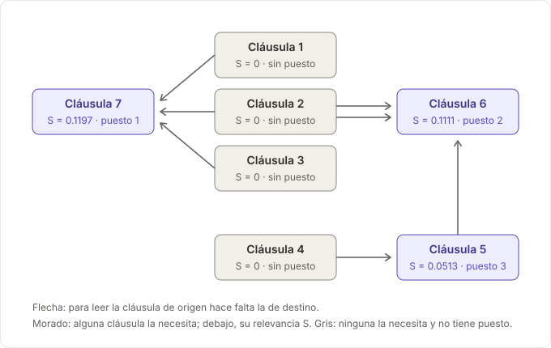

# Relevancia de la cláusula — el orden «by relevance»

Decide en qué orden aparecen las filas del Clause Analyzer cuando el lector dice quién es en
«You are» y la tabla pasa a «by relevance for *parte*».

En una frase:

> **Para la parte que lee, sube la cláusula que sus cláusulas necesitan para leerse.**

Es un PageRank personalizado entre cláusulas que empieza en las cláusulas de esa parte. Lo
calcula `server/services/graph/knowledge/personalized_pagerank.py` y lo sirve
`POST /api/v1/knowledge_graph/<doc>/clause_importance`. Todas las cifras de este documento
salen del fragmento del final, que llama al mismo módulo que usa el servidor.

**Sin parte no hay relevancia.** Qué cláusula importa depende de quién lee, porque cada parte
tiene intereses distintos: un orden único para las dos no decía mucho. Con nadie elegido, la
tabla se ordena por tamaño o por el orden del contrato. Esos dos órdenes no cambian: «by
size» cuenta los cuadrados de la fila y «by order» sigue el contrato.

---

## 1. Los enlaces, y hacia dónde apuntan

Tres aristas del grafo unen una cláusula con otra. Las tres salen del texto: la cláusula
que las escribe nombra a la otra.

El paseo no las recorre como están escritas. Las recorre **de la cláusula que se lee hacia
la que hace falta leer**. Esa flecha se escribe $c' \to c$ y se lee «para leer $c'$ hace
falta $c$»:

| En el grafo | Flecha del paseo | Por qué |
|---|---|---|
| A `modifies` B | $B \to A$ | Quien lee B tiene que ir a A: A la limita, la exceptúa o la cancela. |
| A `depends_on` B | $A \to B$ | Quien lee A tiene que ir a B: si A se aplica depende de B. |
| A `references` B | $A \to B$ | Quien lee A tiene que ir a B: A remite a ella. |

La cláusula a la que llega la flecha es la que recibe relevancia. Por eso `modifies` se
recorre al revés: si A modifica a B, la que hace falta es A.

Tres reglas más:

- **Un enlace que nombra una sección vale para las cláusulas que cuelgan de ella.** Si §13.1
  modifica «el Artículo 11», quien lee §11.1 necesita §13.1. Una sección que es solo un
  título (tiene subcláusulas y ningún enunciado propio) no entra como cláusula.
- **Cada arista cuenta una vez.** Si dos frases de una cláusula modifican a otra, son dos
  flechas.
- **Una cláusula no se enlaza consigo misma.**

**No se sigue nada más:**

- *Las partes.* Cada enunciado está unido a su parte, y la parte repartiría lo que recibe
  entre todos sus enunciados: la fila con más enunciados recibiría más y el orden volvería a
  ser el del tamaño. La parte entra de otra manera: decide dónde empieza el paseo
  (apartado 2).
- *Las condiciones, los valores y las referencias.* Cuelgan de un solo enunciado; no unen
  dos cláusulas.
- *Los términos definidos.* Casi todas las cláusulas usan palabras de «Definitions», que
  quedaría primera para las dos partes sin decir nada nuevo (apartado 4).
- *La jerarquía por sí sola* (subcláusula → sección). Lleva el paseo a la sección sin un
  motivo que se pueda enseñar en la fila.

---

## 2. Las fórmulas

Es un PageRank personalizado sobre ese grafo de cláusulas, leído desde la parte $a$ que el
lector eligió.

**El inicio.** El paseo empieza, y vuelve a empezar, solo en las filas donde la parte tiene
algún enunciado: una obligación o una prohibición que debe cumplir, o un derecho que tiene.
Todas por igual:

$$
\pi_a(c)=\begin{cases}\dfrac{1}{|F_a|} & c\in F_a\\[8pt] 0 & c\notin F_a\end{cases}
$$

**La iteración.** En cada ronda, cada cláusula reparte la mitad de lo que tiene entre las
cláusulas que necesita, y la otra mitad vuelve al inicio:

$$
R_a^{(t+1)}(c)=\bigl(1-d+d\,D^{(t)}\bigr)\,\pi_a(c)\;+\;d\sum_{(c'\to c)\,\in\,E}\frac{R_a^{(t)}(c')}{\operatorname{sal}(c')}
$$

$$
D^{(t)}=\sum_{c\,:\,\operatorname{sal}(c)=0}R_a^{(t)}(c)\qquad\quad R_a^{(0)}=\pi_a\qquad\quad d=0.5
$$

**La parada.**

$$
\sum_{c}\bigl|R_a^{(t+1)}(c)-R_a^{(t)}(c)\bigr|<10^{-9}\qquad\text{o}\qquad t=200
$$

**La relevancia.** Es lo que a cada fila le mandan las cláusulas que la necesitan: el segundo
término de la iteración, con los valores ya estables.

$$
S_a(c)=d\sum_{(c'\to c)\,\in\,E}\frac{R_a(c')}{\operatorname{sal}(c')}
$$

Las filas se ordenan de mayor a menor $S_a(c)$.

### Qué significa cada término

| Término | Significado |
|---|---|
| $c$, $c'$ | Cláusulas del contrato. |
| $F$ | Las filas: las cláusulas con algún enunciado de las dos partes que están en pantalla. |
| $a$ | La parte elegida en «You are». |
| $F_a$ | Las filas donde la parte $a$ tiene algún enunciado. $\lvert F_a\rvert$ es cuántas son. |
| $\pi_a(c)$ | El inicio: la probabilidad de que el paseo empiece, o vuelva a empezar, en $c$. Es igual para todas las filas de la parte y cero para lo demás. |
| $E$ | Las flechas del apartado 1. Si dos aristas del grafo dicen lo mismo, la flecha está dos veces. |
| $c' \to c$ | Una flecha: para leer $c'$ hace falta $c$. |
| $\operatorname{sal}(c')$ | Cuántas flechas salen de $c'$. Lo que tiene $c'$ se reparte a partes iguales entre ellas. |
| $d$ | La probabilidad de seguir una flecha en vez de volver a empezar. Vale 0.5 (apartado 4). |
| $D^{(t)}$ | Lo que hay, en la ronda $t$, en cláusulas de las que no sale ninguna flecha. Como no tienen a dónde ir, vuelve entero al inicio. |
| $R_a^{(t)}(c)$ | La parte del tiempo que el paseo pasa en $c$ en la ronda $t$. Empieza siendo el inicio. |
| $R_a(c)$ | Su valor final. Entre todas las cláusulas suma 1. |
| $S_a(c)$ | La relevancia de $c$ para la parte $a$. Es cero si ninguna cláusula de su camino la necesita. |
| camino de $a$ | Las cláusulas por las que pasa el paseo: las de $F_a$ y las que se alcanzan desde ellas siguiendo flechas. |

### Por qué se ordena por $S_a$ y no por $R_a$

Lo que el paseo deja en una cláusula tiene dos partes:

$$
R_a(c)=\bigl(1-d+d\,D\bigr)\,\pi_a(c)+S_a(c)
$$

- **La primera es el reinicio**, y solo la tienen las filas de la propia parte. Con ella, sus
  cláusulas saldrían con ventaja solo por ser suyas.
- **La segunda es lo que le mandan las cláusulas que la necesitan.** Es lo que se pregunta:
  qué necesitan las cláusulas de la parte, sean de quien sean las que necesitan.

Sin el reinicio, una cláusula donde la parte no tiene ningún enunciado puede quedar primera
si condiciona las suyas.

### Las filas sin puesto

A una fila con $S_a(c)=0$ no la necesita ninguna cláusula del camino de la parte. El grafo no
da ningún motivo para poner una de esas filas delante de otra: empatan y quedan en el orden
del contrato, detrás de las que suben. Qué filas suben depende de la parte, porque solo
suben las que alcanza el paseo desde $F_a$. El tamaño de la fila no entra en ningún paso.

---

## 3. Un ejemplo inventado

Un contrato de siete cláusulas entre Party A y Party B, sin texto. Cada tabla es una pestaña
de la tabla del Clause Analyzer: cuántos cuadrados tiene cada cláusula en cada columna. La
columna «Linked» es la misma en las tres, como en la app: a la izquierda de la línea lo que
la cláusula necesita, a la derecha quién la necesita.

**Obligations**

| Cláusula | Party A | Both | Party B | Linked |
|---|---|---|---|---|
| 1 | 4 | 0 | 1 | Modified by 7 │ – |
| 2 | 7 | 2 | 2 | Modified by 6, 7 │ – |
| 3 | 3 | 1 | 5 | Modified by 7 │ – |
| 4 | 2 | 0 | 9 | Depends on 5 │ – |
| 5 | 10 | 0 | 1 | Refers to 6 │ Needed by 1 (la 4) |
| 6 | 9 | 0 | 2 | – │ Needed by 2 (la 2 y la 5) |
| 7 | 2 | 3 | 3 | – │ Needed by 3 (la 1, la 2 y la 3) |

**Rights**

| Cláusula | Party A | Both | Party B | Linked |
|---|---|---|---|---|
| 1 | 3 | 0 | 8 | Modified by 7 │ – |
| 2 | 7 | 2 | 4 | Modified by 6, 7 │ – |
| 3 | 10 | 1 | 2 | Modified by 7 │ – |
| 4 | 4 | 3 | 6 | Depends on 5 │ – |
| 5 | 2 | 0 | 9 | Refers to 6 │ Needed by 1 (la 4) |
| 6 | 6 | 2 | 3 | – │ Needed by 2 (la 2 y la 5) |
| 7 | 9 | 1 | 5 | – │ Needed by 3 (la 1, la 2 y la 3) |

**Prohibitions**

| Cláusula | Party A | Both | Party B | Linked |
|---|---|---|---|---|
| 1 | 8 | 2 | 1 | Modified by 7 │ – |
| 2 | 4 | 0 | 7 | Modified by 6, 7 │ – |
| 3 | 6 | 3 | 5 | Modified by 7 │ – |
| 4 | 9 | 1 | 2 | Depends on 5 │ – |
| 5 | 3 | 2 | 10 | Refers to 6 │ Needed by 1 (la 4) |
| 6 | 7 | 0 | 4 | – │ Needed by 2 (la 2 y la 5) |
| 7 | 5 | 1 | 6 | – │ Needed by 3 (la 1, la 2 y la 3) |

### Los enlaces

| Arista del grafo | Flecha del paseo |
|---|---|
| 7 `modifies` 1 | $1 \to 7$ |
| 7 `modifies` 2 | $2 \to 7$ |
| 7 `modifies` 3 | $3 \to 7$ |
| 6 `modifies` 2, en dos frases | $2 \to 6$, dos veces |
| 4 `depends_on` 5 | $4 \to 5$ |
| 5 `references` 6 | $5 \to 6$ |



### Dónde empieza cada parte

Party A tiene cuadrados en las siete cláusulas, y Party B también. Un cuadrado de «Both» es
un enunciado de cada una. Así que las dos empiezan en las mismas filas:
$F_A = F_B = \{1,\dots,7\}$ y el inicio es $1/7$ para todas.

Las tablas solo sirven para eso y para el orden «by size»: cuántos cuadrados tiene la parte
en una fila no entra en la fórmula.

### La cuenta, leída desde Party A

Con $d = 0.5$. A las cláusulas 1, 2, 3 y 4 no les manda nada ninguna: se quedan con el
reinicio, que cuando el paseo se estabiliza vale 0.1026. Las otras tres reciben además:

$$
S_A(5)=\tfrac12\,R_A(4)=\tfrac12\cdot 0.1026=0.0513
$$

$$
S_A(6)=\tfrac12\Bigl(R_A(5)+\tfrac23\,R_A(2)\Bigr)=\tfrac12\bigl(0.1538+0.0684\bigr)=0.1111
$$

$$
S_A(7)=\tfrac12\Bigl(R_A(1)+R_A(3)+\tfrac13\,R_A(2)\Bigr)=\tfrac12\bigl(0.1026+0.1026+0.0342\bigr)=0.1197
$$

De la cláusula 2 salen tres flechas, dos a la 6 y una a la 7. Por eso manda $\tfrac23$ de lo
suyo a una y $\tfrac13$ a la otra.

### Las rondas

El paseo empieza en $1/7 = 0.1429$ para todas y se estabiliza en 14 rondas. La última línea
es la relevancia, que se lee de la ronda 14:

| | Cláusulas 1 a 4 | Cláusula 5 | Cláusula 6 | Cláusula 7 |
|---|---|---|---|---|
| $R_A$, ronda 0 | 0.1429 | 0.1429 | 0.1429 | 0.1429 |
| $R_A$, ronda 1 | 0.0918 | 0.1633 | 0.2109 | 0.2585 |
| $R_A$, ronda 2 | 0.1050 | 0.1509 | 0.2172 | 0.2121 |
| $R_A$, ronda 14 | 0.1026 | 0.1538 | 0.2137 | 0.2222 |
| $S_A$ | 0 | 0.0513 | 0.1111 | 0.1197 |

### El resultado

| Puesto | By relevance for Party A | $S_A$ | La necesitan |
|---|---|---|---|
| 1 | Cláusula 7 | 0.1197 | la 1, la 2 y la 3 |
| 2 | Cláusula 6 | 0.1111 | la 2 (dos veces) y la 5 |
| 3 | Cláusula 5 | 0.0513 | la 4 |
| – | Cláusulas 1, 2, 3 y 4 | 0 | ninguna |

La cláusula 6 queda segunda con solo dos cláusulas que la necesitan porque una de ellas, la
5, ya recibe de la 4: ser necesaria para una cláusula que otras necesitan cuenta más.

Para Party B sale lo mismo, porque empieza en las mismas siete filas. La cabecera de la
tabla lo diría: «same for both parties».

### Cuando las dos partes no empiezan en las mismas filas

Las dos lecturas se separan en cuanto una parte no tiene nada en alguna cláusula. Supón que
Party B no tuviera ningún cuadrado, ni propio ni de «Both», en las cláusulas 1, 3 y 4.
Entonces empieza solo en cuatro filas, $F_B = \{2, 5, 6, 7\}$, con inicio $1/4$:

| Puesto | By relevance for Party B | $S_B$ | La necesitan, en el camino de Party B |
|---|---|---|---|
| 1 | Cláusula 6 | 0.1667 | la 2 (dos veces) y la 5 |
| 2 | Cláusula 7 | 0.0333 | la 2 |
| – | Cláusulas 1, 2, 3, 4 y 5 | 0 | ninguna |

- **La cláusula 7 baja de la primera a la segunda.** La 1 y la 3 la necesitan, pero Party B
  no tiene nada en ellas y su paseo no pasa por ahí: solo le manda la 2.
- **La cláusula 5 pierde su puesto.** Solo la necesita la 4, que no está en el camino de
  Party B. Su ficha «Needed by 1» sigue en «Linked»: es un hecho del contrato, no de la
  lectura.
- **Para Party A no cambia nada:** sigue teniendo cuadrados en las siete cláusulas.

### Relevancia y tamaño

El orden por relevancia es el mismo en las tres pestañas, porque no mira los cuadrados. El
orden «by size» cambia de una a otra (el tamaño es Party A más Party B):

| Pestaña | By size |
|---|---|
| Obligations | 4, 5, 6, 2, 3, 1, 7 |
| Rights | 7, 3, 1, 2, 5, 4, 6 |
| Prohibitions | 5, 2, 3, 4, 6, 7, 1 |

En Obligations la cláusula 7 es la última por tamaño y la primera por relevancia: tiene
pocos cuadrados, pero tres cláusulas no se leen bien sin ella.

---

## 4. Por qué esta configuración

El paseo tiene seis decisiones. Cada una se probó contra sus alternativas, sola y combinada
con las demás, en los nueve contratos y desde sus dos partes:
[`notebooks/relevance_parameters.ipynb`](../../notebooks/relevance_parameters.ipynb).
Ninguna alternativa dio un orden mejor, y el 17 de noviembre de 2026 se decidió mantener la
configuración. Las cifras están en el cuaderno; aquí va el motivo de cada una:

| Decisión | Cómo está | Qué pasa con la alternativa |
|---|---|---|
| Damping $d$ | 0.5 | Entre 0.15 y 0.5 el orden casi no cambia. Con 0.7 y 0.85, dos cláusulas que se necesitan la una a la otra se quedan con el paseo y adelantan a cláusulas que muchas necesitan. |
| Dónde empieza | En las filas de la parte, todas por igual | Pesarlas por el número de enunciados casi no cambia nada. Empezar solo en sus obligaciones y prohibiciones, o solo en sus derechos, quita el puesto a filas que lo tenían, y una parte sin obligaciones se queda sin lectura. |
| Qué se lee | $S_a$, sin el reinicio | Con el reinicio, filas que alguna cláusula necesita quedan por debajo de filas que nadie necesita. |
| Qué enlaces se caminan | `modifies`, `depends_on` y `references` | Con uno solo, o sin `references`, muchas filas pierden su puesto. Con los términos definidos, la primera fila pasa a ser la cláusula que define palabras, la misma para las dos partes. |
| Enlaces repetidos | Cuentan cada vez | Contarlos una vez no cambia qué filas suben y añade empates. |
| Cláusulas sin salida | Su peso vuelve al inicio | Repartirlo entre todas las filas da puesto a filas que ninguna cláusula del camino de la parte necesita, y las dos partes se parecen más. |

No se prueba dar un peso distinto a cada tipo de enlace: no hay con qué justificar qué enlace
pesa más.

### El damping, de cerca

$d$ decide cuánto dura el paseo antes de volver a empezar. Con 0.5 sigue de media una sola
flecha más, que es lo que hace quien lee un contrato y salta a la cláusula citada. Con el
valor de siempre, 0.85, sigue casi seis.

Cambiarlo no cambia qué filas suben, solo el orden entre ellas. En el ejemplo, con 0.85 la
cláusula 6 pasa por delante de la 7 (0.1787 frente a 0.1657), porque pesa más la cadena
$4 \to 5 \to 6$.

El motivo para quedarse en 0.5 se ve en los contratos reales. En Bellicum, §9.1 y §9.2 se
necesitan la una a la otra, y §15.1 y §15.2 también. Leído desde Bellicum Pharmaceuticals,
estas son las seis primeras filas; entre paréntesis, cuántas cláusulas necesitan cada una:

| $d$ | 1.ª | 2.ª | 3.ª | 4.ª | 5.ª | 6.ª |
|---|---|---|---|---|---|---|
| 0.5 | §4.10 (10) | §3.2 (10) | §7.7 (7) | §6.5 (1) | §14.3 (7) | §9.1 (2) |
| 0.85 | §4.10 (10) | §9.1 (2) | §9.2 (1) | §15.2 (2) | §15.1 (2) | §3.2 (10) |

Con 0.85 el paseo va y vuelve dentro de cada pareja, y las cuatro acaban por encima de §3.2,
que necesitan diez cláusulas.

Es una elección apoyada en esas pruebas, no un resultado validado: no hay todavía un criterio
externo que diga qué orden es el correcto.
[`notebooks/relevance_damping.ipynb`](../../notebooks/relevance_damping.ipynb) recorre $d$
de 0.01 a 0.99 para el paseo que empieza en todas las filas a la vez, y llega a lo mismo: el
orden aguanta hasta 0.6, y por encima mandan las cláusulas que se necesitan entre sí.

---

## 5. Lo que ve el lector

La cabecera de la tabla ofrece dos órdenes, y un tercero cuando el lector dice quién es,
porque responden a preguntas distintas:

| orden | pregunta | de dónde sale |
|---|---|---|
| **by size** (por defecto) | ¿dónde hay más en juego? | el número de cuadrados del tipo abierto, en las dos columnas |
| **by order** | ¿cómo está escrito? | el orden del contrato |
| **by relevance for** *parte* (solo con «You are») | ¿qué tengo que leer para entender mis cláusulas? | este documento: $S_a(c)$ |

Sin parte elegida, el botón de la cabecera alterna entre «by size» y «by order», y el círculo
de cada fila es su puesto en ese orden.

Con **«You are»**:

- **Elegir una parte ordena la tabla por relevancia, leída desde esa parte.** La cabecera lo
  dice: «by relevance for Orvane ↓». El lector puede volver a «by size» o «by order» cuando
  quiera.
- **Mientras llega el cálculo de la parte, la tabla enseña filas en gris.** Hay tantas como
  filas tenía, con las mismas columnas, y ninguna cláusula: así la tabla nunca muestra las
  filas en un orden que todavía no tiene. Cuando llega, aparecen ya ordenadas. Pasa al elegir
  parte y al cambiar de una a otra.
- **Si el cálculo no llega**, porque la petición falla o porque la parte no tiene ningún
  enunciado, la tabla se queda en «by size» y la cabecera lo dice: «by size ↓ · relevance for
  Talvera unavailable». El botón de la cabecera deja de ofrecer la relevancia. Quitar la parte
  y volver a elegirla lo intenta de nuevo.
- **Quitar la parte** (pulsándola otra vez) quita el orden por relevancia: si la tabla estaba
  así, vuelve a «by size».
- **Si las dos partes dan el mismo orden**, la cabecera añade «same for both parties». Pasa
  en los contratos con pocos enlaces, y evita que el selector parezca no hacer nada.

Con **by relevance**:

- **Primero van las filas que alguna cláusula del camino de la parte necesita**, con su
  puesto en el círculo. El puesto se cuenta dentro de la pestaña abierta: 1, 2, 3… sin saltos.
- **Después van las demás, en el orden del contrato**, con «–» en el círculo.
- **Al pasar el cursor por el círculo** sale el motivo en una frase: «For Talvera, needed to
  read one clause: §8.4 depends on it», o que ninguna de las cláusulas que esa parte tiene
  que leer la necesita.
- **Con «by order» y una parte elegida**, el círculo sigue diciendo el puesto por relevancia
  para esa parte, o «–». Con «by size», el círculo es el puesto por tamaño.

La ficha **«Needed by»** no es parte del orden:

- **Está en «Linked» con cualquier orden, con o sin parte.** Es una ficha oscura al final de
  la celda, a la derecha de una línea fina, y cuenta cuántas cláusulas necesitan la fila
  («Needed by 10»). A la izquierda de la línea siguen las fichas de color, que dicen lo que
  la fila necesita.
- **Dice un hecho del contrato, no de la lectura.** Sale directamente de los enlaces, sin
  ningún paseo, y no cambia al elegir parte. Por eso una fila puede enseñar «Needed by 3» y
  tener «–» en el círculo: la necesitan cláusulas que no están en el camino de esa parte.
- **La lista que se abre sobre «Linked» termina con «Needed by»:** las cláusulas agrupadas
  por relación («Modifies», «Depended on by», «Referred to by»), cada una un botón que lleva
  a esa cláusula.

El documento no cambia: al elegir una cláusula sigue dibujando solo lo que ella necesita.
Quien la necesita se ve en la tabla, y pulsando una de esas cláusulas el documento dibuja el
enlace desde su lado. Hay una excepción: cuando el enlace nombra una sección entera («el
Artículo 11»), hoy solo se ve desde «Needed by». La fila de la subcláusula y el documento
todavía leen la arista tal como está escrita y no lo muestran.

En un contrato sin enlaces entre cláusulas, como lease_contract_166, con cualquiera de las
dos partes todas las filas llevan «–» y «by relevance» coincide con «by order».

---

## 6. En los contratos

Cada contrato leído desde sus dos partes con más enunciados. «Filas» son las cláusulas con
algún enunciado de las dos; «enlaces», las flechas del apartado 1 en todo el contrato;
«filas propias», las filas donde empieza el paseo de esa parte; «suben», las que acaban con
puesto.

| contrato | filas | enlaces | parte | filas propias | suben | primeras filas |
|---|---|---|---|---|---|---|
| Bellicum | 91 | 273 | Miltenyi | 80 | 58 | §4.10, §3.2, §6.5, §7.7, §14.3 |
| | | | Bellicum | 79 | 59 | §4.10, §3.2, §7.7, §6.5, §14.3 |
| Santander | 81 | 83 | Titular | 52 | 22 | §18.8, §5.4, §6.1, §6.3, §8.1 |
| | | | Banco | 55 | 16 | §18.8, §6.1, §6.3, §8.1, §13.1 |
| OrvaneTalvera | 48 | 29 | Orvane | 35 | 19 | §11.2, §9.1, §9.3, §2.2, §10.1 |
| | | | Talvera | 33 | 18 | §2.2, §8.4, §9.2, §5.2, §12.2 |
| HalversonCorvin | 18 | 7 | Corvin | 14 | 4 | §7.2, §9, §8.2, §7.1 |
| | | | Halverson | 13 | 4 | §9, §8.2, §7.1, §7.2 |
| lease_contract_201 | 8 | 7 | Bozhou | 7 | 3 | §2, §7, §4 |
| | | | Anhui | 7 | 2 | §7, §4 |
| lease_contract_10 | 20 | 8 | las dos igual | 18 y 14 | 4 | §13.1, §5, §13.2, §4 |
| Arequipa | 14 | 3 | las dos igual | 12 y 4 | 3 | §10, §11, §14 |
| SteelVault | 22 | 6 | las dos igual | 19 y 18 | 1 | §11 |
| lease_contract_166 | 9 | 0 | las dos igual | 7 y 8 | 0 | — |

El orden cambia con la parte en cinco de los nueve contratos:

- **En OrvaneTalvera cambia lo que el lector ve primero.** Las cinco primeras filas de una y
  otra solo coinciden en §2.2: al proveedor le sube §11.2, el tope de su responsabilidad, y
  al comprador §2.2 y §8.4, la compra exclusiva y la segunda fuente.
- **En Santander coinciden cuatro de las cinco primeras**, y en Bellicum las cinco, con la
  tercera y la cuarta cambiadas. Las dos partes de Bellicum tienen enunciados en casi todas
  las filas (80 y 79 de 91), así que sus paseos empiezan casi en el mismo sitio.
- **En HalversonCorvin y lease_contract_201 suben pocas filas** y cambia el orden entre
  ellas, o una fila que solo sube para una parte.

La primera fila no es la más grande. Su puesto por tamaño es su lugar al ordenar las filas
por número de enunciados:

| lectura | 1.ª por relevancia | puesto por tamaño | la necesitan |
|---|---|---|---|
| Bellicum, las dos partes | §4.10 Disclaimer | 77 de 91 | §4.1 a §4.9 y §8.1 |
| OrvaneTalvera, Orvane | §11.2 | 46 de 48 | §4.2 y §10.1 |
| OrvaneTalvera, Talvera | §2.2 | 33 de 48 | §8.4 |
| SteelVault, las dos partes | §11 Liability | 5 de 22 | §9, y también §8.4 leído desde Equidata |

---

## 7. Qué mide y qué no

- **Dice qué condiciona las cláusulas de la parte, no qué le conviene.** Empieza donde la
  parte tiene algo en juego y sigue los enlaces; no sabe si lo que encuentra la favorece o
  la perjudica, ni conoce sus intereses. Y «parte» es lo único que el grafo distingue: no
  separa a un abogado de un consumidor.
- **Sin parte elegida no ordena la tabla.** No hay un orden por relevancia que valga para
  las dos.
- **Depende de que el contrato tenga enlaces entre cláusulas**, y fuera de Bellicum hay
  pocos. En SteelVault sube una fila de 22; en lease_contract_166, ninguna. Donde no hay
  enlaces el orden no inventa nada: deja las filas como están en el contrato.
- **Donde hay pocos enlaces, las dos partes ven lo mismo.** En cuatro de los nueve contratos
  el orden no cambia con la parte.
- **Hereda los errores de la extracción.** Una arista mal puesta sube una fila que no toca,
  y una cita que la extracción no recogió la deja sin puesto. Por eso cada fila enseña quién
  la necesita: se puede comprobar contra el texto.
- **No mide importancia jurídica.** Dice qué cláusulas condicionan la lectura de otras, no
  cuánto importa cada una para un abogado.
- **No está validado.** No hay todavía un criterio externo con el que comparar el orden: es
  una ayuda para revisar, no un resultado medido.

---

## 8. La ruta, y el otro paseo que devuelve

La ruta recibe `countedStatementIds`, los enunciados en pantalla, que deciden las filas, y
`startStatementIds`, los de la parte elegida.

| campo | de dónde sale | quién lo usa |
|---|---|---|
| `byClause` | la relevancia $S_a(c)$ de este documento. Vacío si no se manda una parte | el orden de las filas y el puesto del círculo |
| `neededBy` | por cada fila, las cláusulas que la necesitan y con qué relación. Con una parte, solo las de su camino | con parte, el motivo del círculo; sin parte, la ficha «Needed by» de «Linked» |
| `byNode`, `priorByNode`, `byStatement` | el paseo sobre el grafo entero y su reinicio | la pestaña del grafo |
| `graphByClause` | lo que ese paseo deja en los enunciados de cada fila | las cláusulas principales de un par de partes |

Sin parte, `neededBy` no viene de ningún paseo: es la lista de enlaces. Cuenta las cláusulas
que necesitan la fila entre las que son filas y las que alguna fila lleva a leer.

**El paseo sobre el grafo entero es otro cálculo.** La pestaña del grafo dibuja también las
partes y los nodos auxiliares, así que usa un paseo sobre todos los nodos, sin dirección,
con $d = 0.85$ y el reinicio repartido entre los enunciados de cada cláusula. La web también
lo usa para elegir las cláusulas principales de un par de partes (`computePairScores`). No
depende de la parte elegida ni tiene que ver con el orden «by relevance»: por eso el puesto
de una cláusula en la tabla y su tamaño en la pestaña del grafo no coinciden.

La web pide tres veces: sin parte (la ficha «Needed by» y la pestaña del grafo), con la parte
elegida (el orden y el círculo) y con la otra (para saber si dan el mismo orden).

---

## Dónde está cada cosa

| Qué | Dónde |
|---|---|
| Las flechas y la regla de las secciones | `needs`, en `server/services/graph/knowledge/personalized_pagerank.py` |
| El inicio en las filas de la parte, $S_a$ y quién necesita a quién | `_relevance`, en el mismo módulo; la parte llega por el argumento `start` de `compute` |
| El camino de la parte | `_reached`, en el mismo módulo |
| La iteración, compartida con el paseo sobre el grafo entero | `walk`, en el mismo módulo |
| La ruta | `ClauseImportanceView`, en `server/api/views.py` |
| «You are» y las tres peticiones | `useYouAre` (en `hooks/useAgainstYou.ts`), `usePartyImportance` (en `hooks/useClauseImportance.ts`) y `useClauseRows`, dentro de `web/src/features/docx/` |
| El orden de las filas, el puesto y quién necesita a cada fila | `web/src/features/docx/hooks/useClauseRows.ts` |
| Las filas en gris mientras llega el cálculo | `WaitingRow`, en `web/src/features/docx/components/clause-analyzer/grid/ClauseGrid.tsx`; cuándo se enseñan lo decide `reading`, en `useClauseRows` |
| El círculo y la ficha «Needed by» | `RankBadge` (en `parts/table-bits.tsx`) y `NeededByTile` y `LinkedCell` (en `grid/ClauseRow.tsx`), dentro de `web/src/features/docx/components/clause-analyzer/` |
| Las alternativas de cada decisión, medidas | [`notebooks/relevance_parameters.ipynb`](../../notebooks/relevance_parameters.ipynb) |
| El damping valor a valor, para el paseo que empieza en todas las filas | [`notebooks/relevance_damping.ipynb`](../../notebooks/relevance_damping.ipynb) |

---

## Cómo regenerar las cifras

Desde `server/`. Primero sale el ejemplo inventado del apartado 3, con su variante, y después
los nueve contratos leídos desde cada parte:

```bash
uv run python - <<'EOF'
import glob, json
from services.graph.knowledge import personalized_pagerank as ppr


def own_statements(kg):
    """Los enunciados de cada parte: las obligaciones y prohibiciones que carga y los derechos que tiene."""
    own = {}
    for kind in ppr.DEONTIC_COLLECTIONS:
        for statement in kg.get(kind) or []:
            party = statement.get('benefitPartyId' if kind == 'rights' else 'burdenPartyId')
            if statement.get('clauseId') and party:
                own.setdefault(party, []).append(statement)
    return own


def read_from(kg, own, pair, party):
    """La relevancia leída desde una parte del par: (resultado, filas, filas que suben en orden)."""
    counted = [statement['id'] for side in pair for statement in own[side]]
    result = ppr.compute(kg, counted, [statement['id'] for statement in own[party]])
    rows = list(result.by_clause)
    rising = sorted(result.needed_by, key=lambda c: (-result.by_clause[c], rows.index(c)))
    return result, rows, rising


def readers(kg, result, clause):
    at = {c['id']: i for i, c in enumerate(kg['clauses'])}
    return sorted({need.reader for need in result.needed_by[clause]}, key=at.__getitem__)


# ---- 1. El ejemplo inventado: siete cláusulas, tres tablas (Party A, Both, Party B) y siete enlaces
TABLES = {
    'obligations':  [(4, 0, 1), (7, 2, 2), (3, 1, 5), (2, 0, 9), (10, 0, 1), (9, 0, 2), (2, 3, 3)],
    'rights':       [(3, 0, 8), (7, 2, 4), (10, 1, 2), (4, 3, 6), (2, 0, 9), (6, 2, 3), (9, 1, 5)],
    'prohibitions': [(8, 2, 1), (4, 0, 7), (6, 3, 5), (9, 1, 2), (3, 2, 10), (7, 0, 4), (5, 1, 6)],
}
LINKS = [(7, 'modifies', 1), (7, 'modifies', 2), (7, 'modifies', 3), (6, 'modifies', 2), (6, 'modifies', 2),
         (4, 'depends_on', 5), (5, 'references', 6)]


def toy(tables):
    """El contrato del ejemplo. Un cuadrado de «Both» es un enunciado de cada parte."""
    kg = {'clauses': [{'id': f'c{i}', 'ref': str(i)} for i in range(1, 8)], 'parties': [{'id': 'A', 'name': 'Party A'}, {'id': 'B', 'name': 'Party B'}],
          'obligations': [], 'rights': [], 'prohibitions': [], 'edges': []}
    written = {}
    for kind, rows in tables.items():
        owner = 'benefitPartyId' if kind == 'rights' else 'burdenPartyId'
        for i, (a, both, b) in enumerate(rows, 1):
            for party, squares in (('A', a + both), ('B', b + both)):
                for k in range(squares):
                    kg[kind].append({'id': f'{kind}-{i}-{party}{k}', 'clauseId': f'c{i}', owner: party})
                    written.setdefault(i, []).append(f'{kind}-{i}-{party}{k}')
    used = {}
    for source, edge, target in LINKS:
        used[source] = used.get(source, 0) + 1
        kg['edges'].append({'type': edge, 'source': written[source][used[source] - 1], 'target': f'c{target}'})
    return kg


def show_toy(kg, party, damping=0.5):
    ppr.RELEVANCE_DAMPING = damping
    own = own_statements(kg)
    result, rows, rising = read_from(kg, own, ['A', 'B'], party)
    ppr.RELEVANCE_DAMPING = 0.5
    starts = sorted({s['clauseId'][1:] for s in own[party]}, key=int)
    print(f'  Party {party}, d = {damping}: empieza en las cláusulas {", ".join(starts)} | '
          + ' | '.join(f'cl. {c[1:]}: S = {result.by_clause[c]:.4f} (la necesitan {", ".join(r[1:] for r in readers(kg, result, c))})' for c in rising)
          + ' | sin puesto: ' + ', '.join(c[1:] for c in rows if c not in rising))


def rounds(kg, party, damping=0.5):
    """El paseo ronda a ronda, escrito aquí con la fórmula del apartado 2."""
    ids = [c['id'] for c in kg['clauses']]
    out = {c: [n.needed for n in ppr.needs(kg) if n.reader == c] for c in ids}
    start = {s['clauseId'] for s in own_statements(kg)[party]}
    prior = {c: (1 / len(start) if c in start else 0.0) for c in ids}
    R = dict(prior)
    print(f'  Party {party}, ronda 0 :', ' '.join(f'{R[c]:.4f}' for c in ids))
    for t in range(1, 200):
        D = sum(R[c] for c in ids if not out[c])
        new = {c: (1 - damping + damping * D) * prior[c] for c in ids}
        for c in ids:
            for needed in out[c]:
                new[needed] += damping * R[c] / len(out[c])
        change = sum(abs(new[c] - R[c]) for c in ids)
        R = new
        if t <= 2 or change < 1e-9:
            print(f'  Party {party}, ronda {t:<2d}:', ' '.join(f'{R[c]:.4f}' for c in ids))
        if change < 1e-9:
            break
    S = {c: sum(damping * R[r] / len(out[r]) for r in ids for needed in out[r] if needed == c) for c in ids}
    print(f'  Party {party}, S       :', ' '.join(f'{S[c]:.4f}' for c in ids))


print('EJEMPLO INVENTADO')
example = toy(TABLES)
print('  flechas:', ', '.join(f'{n.reader[1:]}->{n.needed[1:]}' for n in ppr.needs(example)))
for party in 'AB':
    show_toy(example, party)
rounds(example, 'A')
show_toy(example, 'A', 0.85)
for kind, rows in TABLES.items():
    size = [a + b for a, _, b in rows]
    print(f'  por tamaño en {kind}:', sorted(range(1, 8), key=lambda i: (-size[i - 1], i)), 'tamaños', size)
# La variante: Party B sin cuadrados, ni propios ni compartidos, en las cláusulas 1, 3 y 4.
without = {kind: [(a + both, 0, 0) if i in (1, 3, 4) else (a, both, b) for i, (a, both, b) in enumerate(rows, 1)] for kind, rows in TABLES.items()}
variant = toy(without)
print('  VARIANTE: Party B sin cuadrados en 1, 3 y 4')
for party in 'AB':
    show_toy(variant, party)

# ---- 2. Los nueve contratos, leídos desde las dos partes con más enunciados
print('CONTRATOS')
for path in sorted(glob.glob('../infra/json/kg/root_*.json')):
    kg = json.load(open(path, encoding='utf-8'))
    ref = {c['id']: c.get('ref') for c in kg['clauses']}
    own = own_statements(kg)
    pair = sorted(own, key=lambda party: -len(own[party]))[:2]
    orders = []
    for party in pair:
        result, rows, rising = read_from(kg, own, pair, party)
        orders.append(rising)
        name = next(p['name'] for p in kg['parties'] if p['id'] == party)
        size = {c: 0 for c in rows}
        for side in pair:
            for statement in own[side]:
                size[statement['clauseId']] += 1
        by_size = sorted(rows, key=lambda c: (-size[c], rows.index(c)))
        print(f"{path[22:44]:23s} {name[:24]:25s} filas {len(rows):3d} | enlaces {len(ppr.needs(kg)):3d} | filas propias {len({s['clauseId'] for s in own[party]} & set(rows)):3d} | "
              f"suben {len(rising):3d} | " + ', '.join('§' + ref[c] for c in rising[:5]))
        if rising and any(name in path for name in ('BELLICUM', 'Orvane', 'SteelVault')):
            first = rising[0]
            print(f"{'':49s} la 1.ª, §{ref[first]}: por tamaño {by_size.index(first) + 1} | la necesitan {len(readers(kg, result, first))}: "
                  + ', '.join('§' + ref[r] for r in readers(kg, result, first)))
        if 'BELLICUM' in path and party == pair[1]:
            for damping in (0.5, 0.85):
                ppr.RELEVANCE_DAMPING = damping
                high, _, placed = read_from(kg, own, pair, party)
                print(f"{'':49s} con d = {damping}: " + ', '.join(f'§{ref[c]} (la necesitan {len(readers(kg, high, c))})' for c in placed[:6]))
            ppr.RELEVANCE_DAMPING = 0.5
    print(f"{'':23s} mismo orden para las dos: {'sí' if orders[0] == orders[1] else 'no'} | "
          f"de las cinco primeras, en común: {len(set(orders[0][:5]) & set(orders[1][:5]))}")
EOF
```

«Por tamaño» es el lugar de la fila al ordenar por número de enunciados de las dos partes,
con los empates en el orden del contrato.
