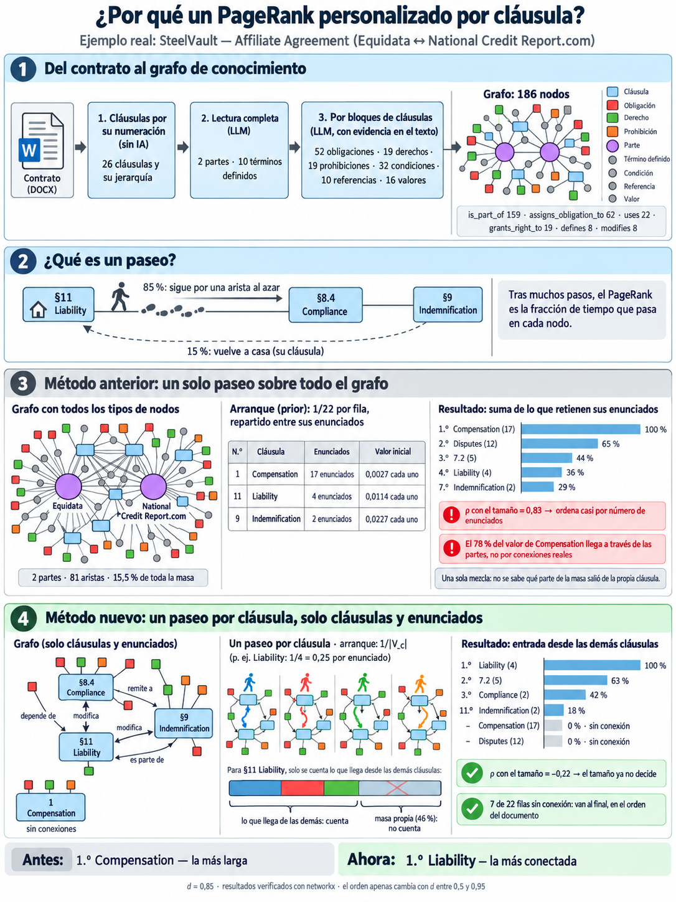
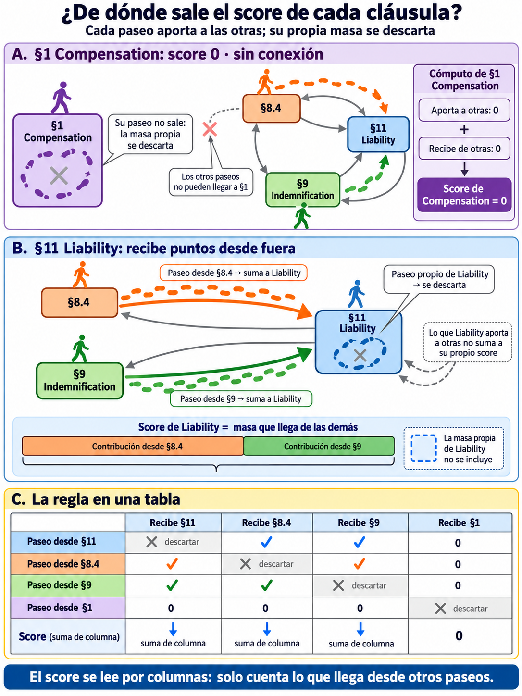

# Importancia de la cláusula — el orden de las filas

Decide en qué orden aparecen las filas del Clause Analyzer cuando el lector elige
«by connection». No dice a quién favorece cada cláusula: eso lo dicen los cuadrados de cada
columna (ver [`reparto-beneficio.md`](./reparto-beneficio.md)).

En una frase:

> **Sube la cláusula con la que más se conecta el resto del contrato.**

La calcula `server/services/graph/knowledge/personalized_pagerank.py` y la sirve
`POST /api/v1/knowledge_graph/<doc>/clause_importance`. Todas las cifras de este documento
las regenera [`notebooks/verify_clause_importance.ipynb`](../../notebooks/verify_clause_importance.ipynb),
que llama al mismo módulo que usa el servidor. Los métodos anteriores y las variantes
descartadas están en [`importancia-clausula-historia.md`](./importancia-clausula-historia.md).

*Resumen visual de todo el documento con SteelVault. Erratas de la imagen; las cifras
correctas son las del texto:*

- *«§8.4 Compliance» (recuadros 2 y 4): §8.4 no se llama Compliance; Compliance es §5.*
- *Recuadro 4: SteelVault no tiene aristas «remite a» ni «depende de», solo `modifies` e
  `is_part_of`. Es Liability la que modifica a §8.4 y a §9 Indemnification.*
- *Recuadro 4, «masa propia (46 %)»: con el método actual, el paseo de Liability se queda el
  40.7 % en sus propios enunciados (apartado 5). El 46 % salía del método anterior.*

---

## 1. De dónde sale el grafo

El grafo de conocimiento se extrae del contrato en tres pasos:

1. **Las cláusulas**, por su numeración, sin IA. El mismo texto da siempre las mismas
   cláusulas, y cada subcláusula queda unida a su sección (`is_part_of`).
2. **Una lectura completa del contrato** (LLM): las partes y los términos definidos.
3. **Una lectura por bloques de cláusulas** (LLM): las obligaciones, los derechos, las
   prohibiciones, sus condiciones, valores y referencias, y las relaciones entre ellos
   (`modifies`, `references`, `depends_on`, `uses`). Cada enunciado guarda el fragmento del
   texto que lo justifica.

Ejemplo, **SteelVault** (*Affiliate Agreement*, entre Equidata y National Credit Report.com):

| nodos | | aristas | |
|---|---|---|---|
| cláusulas | 26 | `is_part_of` | 159 |
| obligaciones | 52 | `assigns_obligation_to` | 62 |
| derechos | 19 | `uses` | 22 |
| prohibiciones | 19 | `grants_right_to` | 19 |
| condiciones | 32 | `defines` | 8 |
| valores | 16 | `modifies` | 8 |
| términos definidos | 10 | | |
| referencias | 10 | | |
| partes | 2 | | |
| **total** | **186** | **total** | **278** |

## 2. Qué parte del grafo se usa

Solo lo que la tabla muestra como filas y cuadrados: **cláusulas, obligaciones, derechos y
prohibiciones**. Las aristas que quedan entre ellos son:

| arista | qué une |
|---|---|
| `is_part_of` | un enunciado con su cláusula, y una subcláusula con su sección |
| `modifies` | un enunciado con la cláusula que limita, amplía o anula |
| `references` | un enunciado o una cláusula con la cláusula que menciona |
| `depends_on` | un enunciado o una cláusula con la cláusula de la que depende |

Quedan fuera las **partes** y los nodos auxiliares: **términos definidos, condiciones,
referencias y valores**. El apartado 6 explica por qué.

El grafo se recorre **sin dirección** y **sin pesos**: todas las aristas valen lo mismo.

## 3. Qué es un paseo

Un paseo es una persona que camina por el grafo:

1. Empieza en los enunciados de una cláusula, que es su «casa».
2. En cada paso, el **85 %** de las veces sigue por una arista al azar hacia un nodo vecino,
   y el **15 %** vuelve a casa.
3. Después de muchísimos pasos se mira **qué fracción del tiempo pasó en cada nodo**. Ese
   reparto es el PageRank personalizado de ese paseo.

Si desde la casa de una cláusula se llega a menudo a otra, es que las dos están bien
conectadas.

## 4. Las tres fórmulas

**Prior.** Hay un paseo por cada cláusula $c$, que arranca repartido por igual entre sus
enunciados:

$$\pi_c(v_i)=\begin{cases}\dfrac{1}{|V_c|} & v_i\in V_c\\[6pt] 0 & \text{en otro caso}\end{cases}$$

**PPR.** La iteración de siempre, sobre el grafo del apartado 2:

$$PR_{c,i}^{(t+1)}=\bigl(1-d+dD_c^{(t)}\bigr)\,\pi_c(v_i)+d\sum_{j\in\mathcal{N}_i}\frac{PR_{c,j}^{(t)}}{\deg(v_j)}$$

**Importancia.** La masa que los paseos de **las demás** cláusulas dejan en los enunciados
de $c$:

$$I(c)=\frac{1}{|C|}\sum_{\substack{c'\in C\\ c'\neq c}}\;\sum_{v_i\in V_c}PR_{c',i}$$

| símbolo | significado |
|---|---|
| $C$ | las cláusulas con algún enunciado en la tabla |
| $V_c$ | los enunciados de $c$ que la tabla muestra en las columnas de las dos partes |
| $\mathcal{N}_i$, $\deg(v_j)$ | vecinos y grado en el grafo del apartado 2 |
| $d$ | 0.85, la probabilidad de seguir caminando |
| $D_c^{(t)}$ | la masa que queda en nodos sin vecinos; vuelve por el prior |

Cada paseo para cuando dos rondas difieren menos de $10^{-9}$, o a las 200 rondas. Las
filas se ordenan de mayor a menor $I(c)$.

El prior solo tiene $1/|V_c|$, sin el $1/|\mathcal{P}|$ de GraphQAG (Li et al., IEEE TVCG,
2026, §IV-A), porque cada paseo sale de una sola cláusula y no hay masa que repartir entre
cláusulas. El reparto entre cláusulas está en el $1/|C|$ de la tercera fórmula. Promediando
los priors de todos los paseos sale exactamente la forma de GraphQAG:

$$\frac{1}{|C|}\sum_{c\in C}\pi_c(v_i)=\frac{1}{|C|\cdot|V_c|}$$

## 5. Cómo leerlo: la tabla de paseos

Un paseo **no** sirve para puntuar a su propia cláusula. Sirve para puntuar a las demás:

- El paseo que empieza en **§11 Liability** deja masa en §8.4 y en §9 Indemnification,
  porque Liability las modifica. Esa masa **suma puntos a §8.4 y a §9**. Lo que se queda en
  la propia Liability se descarta.
- El score de **Liability** sale de los paseos que **empiezan en las otras cláusulas** y
  llegan hasta ella.

En SteelVault, en porcentaje de la masa de cada paseo:

| el paseo empieza en ↓ / deja masa en → | §11 Liability | §8.4 | §9 Indemnification | §1 Compensation |
|---|---|---|---|---|
| §11 Liability | ~~40.7 %~~ | 3.5 % | 5.5 % | 0 % |
| §8.4 | 11.3 % | ~~26.9 %~~ | 0.8 % | 0 % |
| §9 Indemnification | 18.0 % | 0.8 % | ~~34.4 %~~ | 0 % |
| §1 Compensation | 0 % | 0 % | 0 % | ~~52.1 %~~ |

- Cada **fila** es un paseo: empieza en una cláusula y reparte masa por el contrato.
- Cada **columna** es una cláusula que recibe masa.
- El **score** de una cláusula es la suma de su columna **sin la diagonal**, sobre las 22
  cláusulas, dividida por $|C| = 22$.

Lo que falta en cada fila hasta el 100 % se queda en los nodos de cláusula, que no son
enunciados, y en las cláusulas que no aparecen en esta tabla.

**Liability** recibe sobre todo de §9 Indemnification (18.0 %) y de §8.4 (11.3 %), y un poco
de §8.1, §8.2 y §8.3. Por eso queda primera.

**Compensation** no tiene ninguna arista hacia otra cláusula:

- su propio paseo nunca sale de ella, así que no da puntos a nadie, y lo que deja en ella
  misma se descarta;
- los paseos de las demás nunca llegan a ella, así que su columna suma 0.

Queda con score 0: **sin conexión**.

*La misma idea en dibujo: arriba Compensation, que ni da ni recibe; en medio Liability, que
recibe de §8.4 y de §9 y descarta su propia masa; abajo, la tabla de paseos. Errata de la
imagen: en la barra de Liability, la contribución de §9 es mayor que la de §8.4 (18.0 % frente
a 11.3 %), y también le llega algo de §8.1, §8.2 y §8.3, que la barra no muestra.*

## 6. Por qué así

### Por qué un paseo por cláusula y no uno solo

Con un solo paseo sobre todo el documento, el valor de cada cláusula es la suma de su
columna **con** la diagonal, y la diagonal no se puede separar del resto: la masa queda
mezclada y no se sabe de qué cláusula salió. Esa diagonal es la masa que la cláusula se da a
sí misma, y en un solo paseo es casi todo:

| contrato | parte del valor que es masa propia, con un solo paseo |
|---|---|
| Bellicum | 72 % de media (de 40 % a 97 %) |
| Santander | 69 % (de 29 % a 100 %) |
| SteelVault | 82 % (de 53 % a 100 %) |
| HalversonCorvin | 87 % (de 44 % a 100 %) |
| OrvaneTalvera | 83 % (de 32 % a 100 %) |
| lease 10 | 86 % (de 57 % a 100 %) |
| lease 201 | 82 % (de 50 % a 100 %) |
| lease 166 | 100 % |

La masa propia depende de cuántos enunciados tiene la cláusula y de cómo se unen entre sí,
no del resto del contrato. En lease 166 ninguna cláusula conecta con otra y el 100 % del
valor es masa propia: un solo paseo daría igualmente un orden, pero sería un orden sin
contenido. Con un paseo por cláusula se ve lo que de verdad pasa: todas tienen entrada 0.

### Por qué el paseo no pasa por las partes

Cada enunciado está unido a su parte, y la parte reparte lo que recibe entre **todos** sus
enunciados. Una fila con más enunciados recibe más, y el orden vuelve a ser «primero las
filas con más cuadrados», algo que el lector ya ve en la tabla. Con las partes dentro del
paseo, la correlación con el tamaño de la fila sube a 0.85–0.97.

Las partes siguen en la tabla como columnas. Solo dejan de ser un camino entre cláusulas.

### Por qué quedan fuera los nodos auxiliares

Los términos definidos, las condiciones, las referencias y los valores no se ven en la
tabla. Con ellos el orden dependería de cosas que el lector no puede comprobar: dos
cláusulas parecerían conectadas solo por usar el mismo término definido, aunque ninguna
mencione a la otra.

## 7. Antes y ahora, en SteelVault

El **método anterior** era un solo paseo sobre el grafo entero, con las partes y los nodos
auxiliares incluidos, el prior $1/(|C|\cdot|V_c|)$ y la suma de lo que retienen los
enunciados de cada fila. En ese método las dos partes se quedaban el 15.5 % de toda la masa.

| cláusula | enunciados | antes | puesto | ahora | puesto |
|---|---|---|---|---|---|
| 11 Liability | 4 | 36 % | 4.º | **100 %** | **1.º** |
| 7.2 | 5 | 44 % | 3.º | 63 % | 2.º |
| 5 Compliance | 2 | 18 % | 20.º | 42 % | 3.º |
| 8.4 | 2 | 24 % | 12.º | 33 % | 4.º |
| 9 Indemnification | 2 | 29 % | 7.º | 18 % | 11.º |
| 1 Compensation | 17 | **100 %** | **1.º** | 0 % | – |
| 2 Disputes | 12 | 65 % | 2.º | 0 % | – |

*(porcentaje de la cláusula con más valor en cada método)*

Antes, la primera era **Compensation**, la cláusula con más enunciados. El 78 % de su valor
le llegaba de otras cláusulas, pero a través de las dos partes, no por conexiones reales.
Ahora la primera es **Liability**, que modifica a §8.4 y a §9 Indemnification.

## 8. Lo que ve el lector

La cabecera de la tabla ofrece tres órdenes, porque responden a preguntas distintas:

| orden | pregunta | de dónde sale |
|---|---|---|
| **by size** (por defecto) | ¿dónde hay más en juego? | el número de cuadrados del tipo abierto, en las dos columnas |
| **by connection** | ¿qué cláusula cambia o condiciona a otras? | este documento: $I(c)$ |
| **by order** | ¿cómo está escrito? | el orden del documento |

**by size** es el orden por defecto (decisión del 30 de octubre de 2026). Un lector entiende
«importante» como «muchas obligaciones», y ese orden responde justo a eso, con cuadrados que
puede contar. **by connection** se llamaba «by relevance»; se renombró porque «relevante»
sugería importancia en general, y lo que mide es conexión. No se mezclan los dos en un solo
número: haría falta decidir cuánto pesa cada uno, y eso es un peso.

Con **by size**, el círculo de cada fila es su puesto en esa pestaña: 1, 2, 3… sin saltos.
Los empates quedan en el orden del documento.

Con **by connection**:

- Las filas conectadas van primero, con su puesto por conexión en el círculo.
- Las filas con $I(c) = 0$ van al final, en el orden del documento, con «–» en el círculo.
  Una línea las separa: *«Not connected to any other clause · document order»*.
- Si **ninguna** fila tiene conexión, como en lease 166, «by connection» queda desactivado.
- El puesto se calcula una sola vez con los tres tipos de enunciado, así que en cada pestaña
  los números pueden saltar.
- La fila que modifica a otra lo dice: «modifies §8.4, §9». Así se ve en la propia fila por
  qué está arriba.

Con **by order**, el círculo muestra el puesto por conexión.

## 9. Comprobaciones

**El cálculo es exacto.** Rehecho con `networkx` paseo a paseo, la diferencia máxima con el
módulo va de $3\cdot10^{-13}$ a $3\cdot10^{-11}$ según el contrato.

**Ya no premia el tamaño.** ρ es la correlación de Spearman entre el orden de las filas y su
número de enunciados: cerca de 1, el orden solo cuenta enunciados; cerca de 0, el tamaño no
lo decide.

| contrato | filas | ρ antes | ρ ahora | filas sin conexión |
|---|---|---|---|---|
| Bellicum | 91 | 0.92 | 0.48 | 0 |
| Santander | 81 | 0.85 | 0.50 | 3 |
| SteelVault | 22 | 0.83 | −0.22 | 7 |
| HalversonCorvin | 19 | 0.89 | −0.22 | 9 |
| OrvaneTalvera | 48 | 0.59 | −0.03 | 26 |
| lease 10 | 20 | 0.82 | −0.12 | 8 |
| lease 201 | 8 | 0.89 | 0.04 | 2 |
| lease 166 | 9 | 0.81 | — | 9 (todas) |

Un ρ bajo solo dice que el orden ya no es «contar enunciados». No prueba que el orden sea el
correcto: un orden al azar también daría ρ ≈ 0.

**No depende de $d$.** Con $d$ entre 0.5 y 0.95, el orden apenas cambia frente a
$d = 0.85$: ρ entre 0.89 y 1.00, y se mantienen entre 7 y 10 de las 10 primeras filas (en
lease 201, que tiene 8, se mantienen todas).

Entre estos contratos, Bellicum y SteelVault son los grafos que se dan por fiables.

## 10. Qué mide y qué no

- **Mide conexión en los dos sentidos.** Como el grafo no tiene dirección, una cláusula sube
  tanto si otras la modifican como si ella modifica a otras.
- **La jerarquía cuenta como conexión.** Una sección recibe masa de sus subcláusulas a
  través de `is_part_of`. Es razonable, porque forman parte de lo mismo, pero una sección con
  muchas subcláusulas tiende a subir: puede explicar parte del ρ = 0.48 de Bellicum.
- **No mide importancia jurídica.** Dice cuánto se conecta una cláusula con el resto del
  contrato, no cuánto importa para un abogado.
- **Una fila sin conexión puede ser un hueco de la extracción.** Si el texto menciona otra
  cláusula y la extracción no lo recogió, la fila queda en 0.
- **Es del contrato, no de una parte.** Responde «qué cláusula conecta más en este contrato»,
  nunca «para quién».

### La pestaña del grafo usa otro paseo

La pestaña del grafo sigue mostrando el paseo anterior, sobre el grafo entero, porque dibuja
también las partes y los nodos auxiliares. El endpoint devuelve los dos:

| campo | de dónde sale |
|---|---|
| `byClause` | la importancia $I(c)$ de este documento: ordena las filas |
| `byNode`, `byStatement`, `priorByNode` | el paseo único sobre el grafo entero, para la pestaña del grafo |

Por eso `byClause` ya no es la suma de `byStatement`, y la importancia de una cláusula en la
tabla y en el grafo no coincide.
